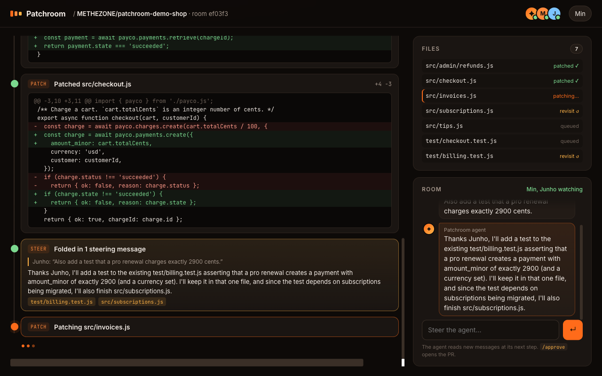
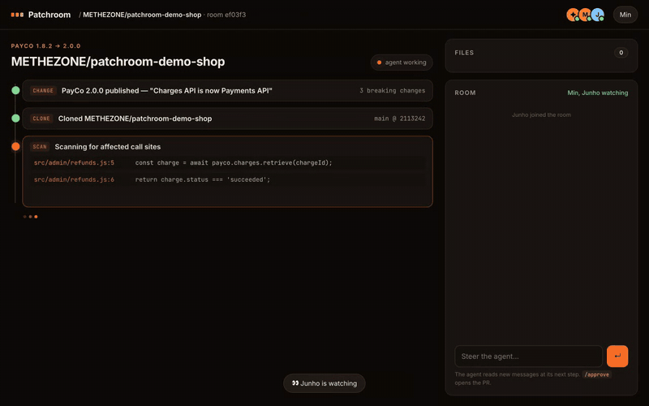
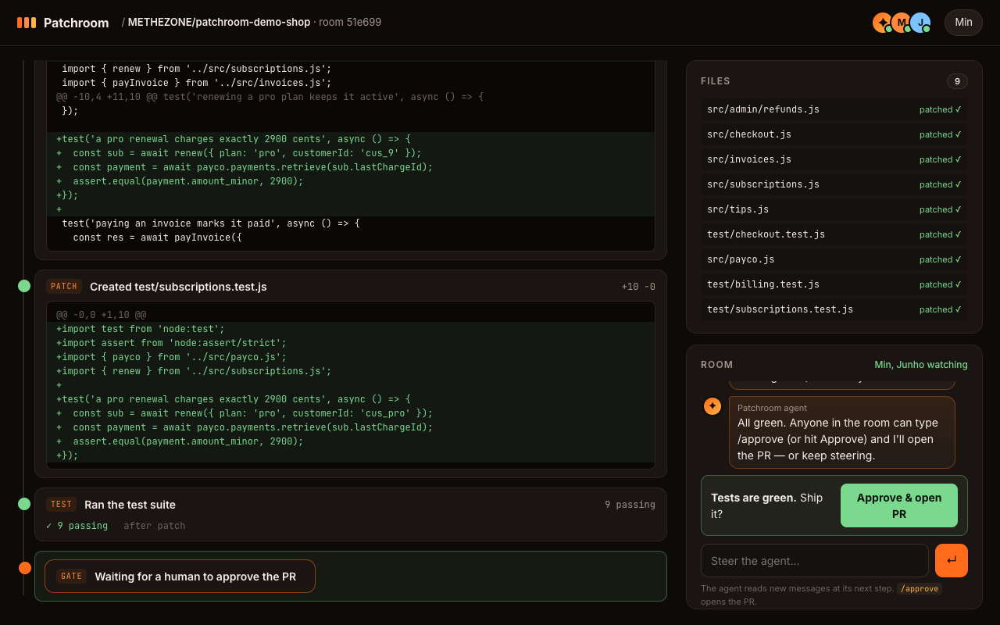
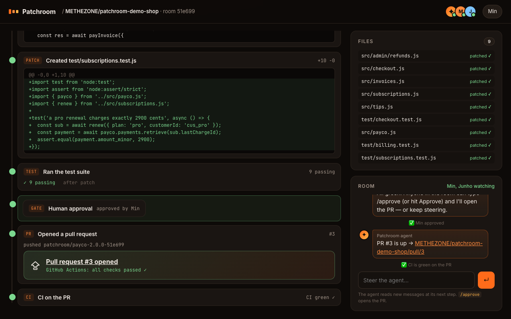

# Patchroom

**Multiplayer Dependabot for APIs.** When an API provider ships a breaking change, Patchroom finds every affected customer repo, and an agent migrates the code inside a **live, shared room**. Anyone from the customer team or the provider's DevRel can drop in, watch every step, steer the agent mid-run, and approve. Then it opens a real pull request with green CI.



**Live result from the demo run:** [METHEZONE/patchroom-demo-shop#5](https://github.com/METHEZONE/patchroom-demo-shop/pull/5). The PayCo 2.0 migration across 6 files includes the test Junho asked for mid-run, approved in the room by Min, with GitHub Actions green. Real two-browser recording (no audio, 74 s): [`docs/demo-side-by-side.mp4`](docs/demo-side-by-side.mp4).



| Two people, one room | Human gate → PR + CI |
|---|---|
|  |  |

> Built in one day at the c0mpiled-17 Seoul hackathon (2026-11-09). It combines two YC Fall 2026 Requests for Startups:
> - **[Self-Maintaining APIs](https://www.ycombinator.com/rfs)** (Harsha Gaddipati): "Dependabot for APIs". When Stripe ships a breaking change, an agent fixes every customer's code and opens the PR.
> - **[Multiplayer AI](https://www.ycombinator.com/rfs)** (Aaron Epstein): agent sessions should be shared and live, not private chats. The idea is inspired by [yc-software/qm](https://github.com/yc-software/qm).

## The problem

API providers spend months on deprecation emails nobody reads. Their customers dig through changelogs, find every call site, fix the float-to-cents bug they didn't know about, and hope the tests catch the rest. An agent can do most of that work. A *private* agent chat, though, is the wrong shape for it: the customer engineer, their teammate, and the provider's DevRel each hold part of the context ("keep the old param until v3", "also test EUR"), and none of them can see what the agent is doing.

## How it works

```
 provider publishes change.json ─▶ Patchroom finds subscribed repos ─▶ one live room per repo
                                                                          │
   ┌──────────────────────────────── agent loop (streams every event to the room) ─────┐
   │ clone → scan call sites → bump SDK (tests go red) → plan → patch file-by-file      │
   │        ▲ between every step: drain steering messages, triage with the LLM,         │
   │        │ acknowledge publicly, re-queue the files the instruction touches          │
   │ run tests → self-repair on failure → wait for a human /approve → push → gh pr      │
   │ create → watch GitHub Actions until green                                         │
   └────────────────────────────────────────────────────────────────────────────────────┘
          ▲ SSE (everyone sees the same timeline)        │ POST /chat, /approve (anyone can steer)
          └── Min's browser ── Junho's browser ── DevRel's browser ──┘
```

- **Shared session, not a private chat.** The room is the single source of truth: an append-only event log streamed over SSE. A late joiner replays it and lands in the same state. Presence shows who is watching.
- **Steering at step boundaries.** Messages queue (`queued` → `acknowledged` → `applied ✓`). Before each step, the agent drains the queue and asks the LLM how each message changes the plan. It replies in the room, addressing the person by name, and re-queues the files it will (re)touch. Later patches get every accepted instruction as a hard constraint.
- **Proof, not vibes.** The agent bumps the SDK first, so tests go red. It patches until they pass and repairs itself from test output if they don't. A human approves before anything is pushed. The PR body credits who steered and who approved.
- **Real artifacts.** It runs `git clone`, makes real file edits, runs `npm test`, and uses `gh pr create` and `gh pr checks`. Demo target: [METHEZONE/patchroom-demo-shop](https://github.com/METHEZONE/patchroom-demo-shop).

The provider change is plain JSON ([`providers/payco/change.json`](providers/payco/change.json)). The demo uses **PayCo**, a fake Stripe-like SDK: `charges.create(amount_float)` becomes `payments.create({ amount_minor, currency })`, and `charge.status` becomes `payment.state`.

## 60-second quickstart

Requirements: Node 20+, `gh` logged in (with push access to the target repo), and any OpenAI-compatible chat endpoint.

```bash
git clone https://github.com/METHEZONE/patchroom && cd patchroom
npm start                                   # → http://localhost:4317
```

1. Open `http://localhost:4317/?as=Min` and click **⚡ Publish PayCo 2.0.0**.
2. Open the same room URL in a second window as `?as=Junho`.
3. While the agent patches, type into the room: *"Also add a test that a pro renewal charges exactly 2900 cents."*
4. When tests are green, click **Approve & open PR** (or type `/approve`), then watch CI go green.

LLM configuration (defaults shown):

| env | default |
|---|---|
| `PATCHROOM_LLM_BASE` | `http://127.0.0.1:8787/v1` (any OpenAI-compatible `/chat/completions`) |
| `PATCHROOM_LLM_TOKEN` | read from `~/.ai-gateway/token` |
| `PATCHROOM_MODELS` | `claude-sonnet-5-5,gpt-6.1-sol` (tried in order) |
| `PATCHROOM_AUTO_APPROVE_MS` | off. Set it to auto-approve after N ms. |

To target your own repo, edit `providers/subscribers.json`.

Headless end-to-end check (two simulated viewers, one steering message, auto-approve):

```bash
npm start &   npm run smoke
```

Recorded two-browser demo (Playwright, system Chrome):

```bash
npm i && npm start &   npm run demo    # → recordings/min.webm, recordings/junho.webm, docs/*.png
```

## Repo map

| path | what |
|---|---|
| `src/server.mjs` | HTTP + SSE server, provider publish endpoint, room API |
| `src/room.mjs` | shared session: event log, presence, steering queue, approval gate |
| `src/agent.mjs` | migration agent: clone → scan → bump → plan → patch → test → repair → approve → PR → CI |
| `src/llm.mjs` | streaming OpenAI-compatible client with model fallback |
| `public/` | the room UI (vanilla JS, no build step) |
| `providers/payco/` | the provider's changelog, change spec and new SDK |

## What's next

- AST codemods for mechanical renames, with the LLM only for semantic edits like money units.
- Provider-side dashboard: one change, N customer rooms, migration progress across the ecosystem.
- Slack and GitHub-comment surfaces for the same room, QM-style.
- Hand-off: "Junho, take it from here" transfers the approval role.

MIT © METHEZONE
